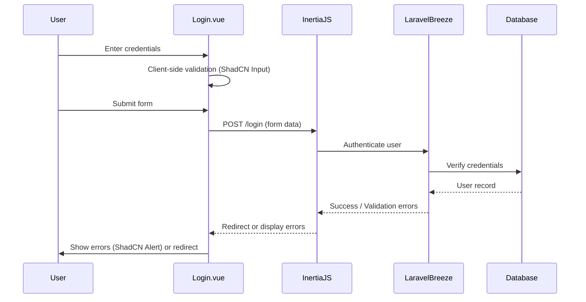

# Authentication Views using ShadCN Vue

## Description

Migrate all authentication views from Laravel Breeze's default templates to use ShadCN Vue components, modernizing the authentication UI while enhancing validation and maintaining all existing backend functionality. This migration improves UI consistency, accessibility, and developer experience by leveraging ShadCN's design system.

The scope includes six authentication views:
- `ConfirmPassword.vue` - Password confirmation for sensitive operations
- `ForgotPassword.vue` - Password reset request form
- `Login.vue` - User login form
- `Register.vue` - New user registration form
- `ResetPassword.vue` - Password reset with token
- `VerifyEmail.vue` - Email verification prompt

**Design Decisions** (based on clarification):
- **Validation Enhancement**: Enhance client-side validation using ShadCN's form patterns while maintaining server-side validation from Breeze
- **Theme**: Use ShadCN's default theme configuration without custom branding
- **Component Scope**: Authentication components are scoped strictly to auth flows, not reusable across the application

**Assumptions**:
- Laravel Breeze backend (routes, controllers, middleware, validation) remains unchanged
- ShadCN Vue components are already installed and configured in the project
- InertiaJS integration for server-side rendering and form handling is preserved
- No changes to authentication flow, session management, or security logic

## Requirements / Acceptance Criteria / Definition of Done

### Functional Requirements
- [ ] All six authentication views are migrated to use ShadCN Vue components (Button, Input, Label, Card, etc.)
- [ ] All form fields from original Breeze templates are preserved with correct types and attributes
- [ ] **Enhanced client-side validation** using ShadCN's form patterns (real-time validation, better UX feedback)
- [ ] Server-side validation from Breeze backend works correctly and displays errors appropriately
- [ ] Error messages display correctly using ShadCN's feedback components with improved clarity
- [ ] Success messages and redirects function as expected
- [ ] "Remember me" checkbox (Login.vue) functions correctly
- [ ] Password visibility toggle works in password fields
- [ ] Loading states are displayed during form submission
- [ ] All links (forgot password, register, login) navigate correctly
- [ ] Form field validation provides immediate feedback (on blur, on input, or on submit as appropriate)

### Non-Functional Requirements
- [ ] Views are fully responsive across mobile, tablet, and desktop breakpoints
- [ ] WCAG 2.1 Level AA accessibility compliance (keyboard navigation, ARIA labels, focus management)
- [ ] Forms work correctly with browser autofill and password managers
- [ ] No breaking changes to existing authentication routes or backend logic
- [ ] Code passes ESLint and follows Vue 3 Composition API style guide
- [ ] All components use JavaScript (not TypeScript) with `<script setup>` syntax

### Component Modularity
- [ ] Authentication components are extracted to `resources/js/components/auth/*.vue`
- [ ] Shared components include at minimum: form inputs, buttons, error displays, and card wrappers
- [ ] Components are **scoped strictly to authentication flows** (not designed for reuse in other modules)
- [ ] Components are documented with props, events, and usage examples
- [ ] GuestLayout is created in `resources/js/Layouts/` for auth/guest page structure

### Testing & Quality
- [ ] Manual testing completed for all authentication flows in Chrome, Firefox, and Safari
- [ ] Accessibility tested with keyboard navigation and screen reader
- [ ] All migrated files are committed with clear commit messages
- [ ] Changes are documented in PR description with before/after screenshots

## Technical Specifications / Implementation Details / Scope of Work

### File Structure

```
resources/js/
├── Pages/Auth/
│   ├── ConfirmPassword.vue      [MIGRATE]
│   ├── ForgotPassword.vue       [MIGRATE]
│   ├── Login.vue                [MIGRATE]
│   ├── Register.vue             [MIGRATE]
│   ├── ResetPassword.vue        [MIGRATE]
│   └── VerifyEmail.vue          [MIGRATE]
├── Layouts/
│   └── GuestLayout.vue          [CREATE] - Auth/guest layout wrapper
└── components/auth/
    ├── AuthCard.vue             [CREATE] - Card wrapper for auth forms
    ├── AuthInput.vue            [CREATE] - Input with label and error display
    ├── AuthButton.vue           [CREATE] - Consistent button styling
    └── AuthError.vue            [CREATE] - Error message display
```

**Note**: All files are JavaScript (.vue with `<script setup>`), not TypeScript.

### ShadCN Components to Use

| View              | ShadCN Components                                  |
|-------------------|----------------------------------------------------|
| ConfirmPassword   | Card, Input, Label, Button, Alert                  |
| ForgotPassword    | Card, Input, Label, Button, Alert                  |
| Login             | Card, Input, Label, Button, Checkbox, Alert        |
| Register          | Card, Input, Label, Button, Alert                  |
| ResetPassword     | Card, Input, Label, Button, Alert                  |
| VerifyEmail       | Card, Button, Alert                                |

### Implementation Steps

1. **Setup & Planning**
   - Audit existing Breeze views for all form fields, validation, and logic
   - Identify common patterns for extraction into shared components
   - Review ShadCN Vue documentation for component APIs

2. **Create Shared Components** (scoped to authentication only)
   - `GuestLayout.vue` (`resources/js/Layouts/`): Page-level layout for auth/guest pages with logo, title, and responsive container
   - `AuthCard.vue` (`resources/js/components/auth/`): Centered card container with consistent padding and shadows
   - `AuthInput.vue` (`resources/js/components/auth/`): Input field with integrated label, real-time validation, error display, and accessibility attributes
   - `AuthButton.vue` (`resources/js/components/auth/`): Primary/secondary button variants with loading states
   - `AuthError.vue` (`resources/js/components/auth/`): Error message display with icons and styling

3. **Migrate Each View**
   - Replace HTML markup with ShadCN components using default theme
   - Update form handling to use Inertia form helpers
   - **Implement enhanced client-side validation** with real-time feedback
   - Ensure validation errors map correctly to field-level displays
   - Test form submission, error handling, and success flows
   - Verify accessibility with keyboard navigation

4. **Integration & Testing**
   - Test all authentication flows end-to-end
   - Verify browser compatibility (Chrome, Firefox, Safari)
   - Check responsive behavior on mobile and tablet
   - Test with screen readers and keyboard-only navigation
   - Validate against existing Breeze backend without changes

### Data Flow (Login Example)



### Security & Validation Considerations

- Preserve CSRF token handling via InertiaJS
- Maintain rate limiting on authentication endpoints
- Ensure password fields use `type="password"` with visibility toggle
- Keep existing server-side validation rules unchanged
- **Enhance client-side validation** with:
  - Real-time field validation (email format, password strength, required fields)
  - Clear, immediate feedback on validation errors
  - Field-level validation states (valid, invalid, pending)
  - Helpful validation messages using ShadCN's error patterns
- Display validation errors per-field using ShadCN's error states
- Maintain "Remember me" token functionality
- Ensure validation doesn't compromise security (client-side is UX only, server-side is authoritative)

### Styling & Theming

- **Use ShadCN's default theme configuration** from `tailwind.config.js` (no custom branding)
- Ensure consistent spacing, typography, and color usage across all views
- Maintain dark mode support if configured in ShadCN setup
- Use TailwindCSS utility classes for layout and responsive design
- Do not create custom design tokens or override default ShadCN styles

### Example: Login.vue Migration

**Before (Breeze Default)**:
```vue
<template>
  <form @submit.prevent="submit">
    <div>
      <label for="email">Email</label>
      <input id="email" type="email" v-model="form.email" required />
      <div v-if="form.errors.email">{{ form.errors.email }}</div>
    </div>
    <button type="submit">Log in</button>
  </form>
</template>
```

**After (ShadCN with GuestLayout)**:
```vue
<script setup>
import GuestLayout from '@/Layouts/GuestLayout.vue'
import AuthInput from '@/components/auth/AuthInput.vue'
import AuthButton from '@/components/auth/AuthButton.vue'
import { useForm } from '@inertiajs/vue3'

const form = useForm({
  email: '',
  password: '',
  remember: false
})

const submit = () => {
  form.post(route('login'))
}
</script>

<template>
  <GuestLayout title="Login to your account">
    <form @submit.prevent="submit">
      <AuthInput
        id="email"
        v-model="form.email"
        label="Email"
        type="email"
        :error="form.errors.email"
        required
      />
      <AuthButton type="submit" :loading="form.processing">
        Log in
      </AuthButton>
    </form>
  </GuestLayout>
</template>
```

## Risk Assessment / Mitigation / Dependencies / Blockers / Assumptions

### Risks
| Risk | Impact | Mitigation |
|------|--------|------------|
| ShadCN component API changes | Medium | Pin ShadCN version and review changelog before updates |
| Breaking Breeze backend integration | High | Thorough testing of all auth flows; no backend changes allowed |
| Accessibility regressions | Medium | Use WCAG checklist and test with assistive technologies |
| Inconsistent UI across views | Low | Create shared components and establish design tokens early |

### Dependencies
- **ShadCN Vue**: Must be installed and configured with TailwindCSS
- **InertiaJS**: Required for form handling and server-side rendering
- **Laravel Breeze**: Backend authentication logic must remain stable
- **Vue 3 Composition API**: All components use `<script setup>` syntax

### Blockers
- Missing or incomplete ShadCN Vue documentation may require component exploration
- If ShadCN components are not yet installed, installation must be completed first

### Assumptions
- ShadCN Vue is compatible with the current Vue 3 and Vite setup
- No changes to authentication routes, controllers, or middleware are required
- Existing tests (if any) for authentication flows will be updated separately
- Dark mode support is not required unless explicitly configured

## Additional Notes / References / Resources / Links

### External References
- [ShadCN Vue Documentation](https://www.shadcn-vue.com/)
- [Laravel Breeze Documentation](https://laravel.com/docs/11.x/starter-kits#breeze)
- [InertiaJS Forms Documentation](https://inertiajs.com/forms)
- [Vue 3 Composition API Guide](https://vuejs.org/guide/extras/composition-api-faq.html)
- [WCAG 2.1 Guidelines](https://www.w3.org/WAI/WCAG21/quickref/)

### Internal References
- Project coding standards: `.github/instructions/coding-standards-vilt.instructions.md`
- Related issues: None (independent ticket)

### Design Resources
- ShadCN default theme configuration: `tailwind.config.js`
- Existing component library: `resources/js/components/ui/`

### Follow-up Considerations
- If authentication views require custom branding, create a follow-up ticket for theme customization
- Consider extracting ShadCN form components into a shared form library if used beyond authentication
- Evaluate adding unit tests for authentication components in a separate ticket
