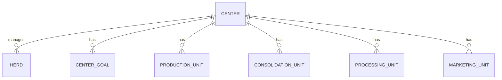

# Center Data Modeling

## Clarifying Questions

1. What are the specific data attributes and relationships required for each unit (Production, Consolidation, Processing, Marketing) under a Center?
2. Should the data model support historical tracking of changes (e.g., goals, units, herd assignments) or is only the current state needed?
3. Are there any existing constraints, validation rules, or integration requirements with other PCC systems or external data sources?

## Description

This ticket covers the normalization and modeling of the "Center" entity for the PCC system. A Center is an institution that manages Institutional Herds and operates across the value chain: Production, Consolidation, Processing, and Marketing. The goal is to design a normalized data model that accurately represents Centers, their associated Herds, and their operational units, in alignment with the referenced PCC data dictionary and the provided spreadsheet. 

Assumptions:
- The data model will be based on the relationships described in the ticket and the referenced spreadsheet.
- If any clarifications above are not answered, the model will be designed for current-state data only, with standard Laravel validation and no external system integration.

## Requirements / Acceptance Criteria / Definition of Done

- A normalized data model for Centers, including:
	- Center entity with attributes as per PCC requirements
	- Relationships: Center has many Herds
	- Center has one or many of each unit: Production, Consolidation, Processing, Marketing
	- Center Goals entity/relationship for each value chain unit
- Database migrations created and reviewed
- Eloquent models and relationships implemented in `app/Models`
- All fields and relationships documented in code comments
- Unit tests for model relationships and constraints
- Documentation updated to reflect the new data model

## Technical Specifications / Implementation Details / Scope of Work

- Review the referenced spreadsheet and PCC data dictionary for required fields and relationships
- Create Laravel migrations for:
	- `centers` table (core attributes)
	- `herds` table (with foreign key to `centers`)
	- `center_goals` table (with foreign key to `centers` and type for value chain unit)
	- `production_units`, `consolidation_units`, `processing_units`, `marketing_units` tables (each with foreign key to `centers`)
- Implement Eloquent models for each entity in `app/Models`
- Define relationships in models (hasMany, belongsTo, etc.)
- Add validation rules in model or request classes as appropriate
- Update or create relevant seeders/factories for test data
- Add/Update documentation in `README.md` or a dedicated data model doc

### Example Entity Relationship Diagram (Mermaid)

## Risk Assessment / Mitigation / Dependencies / Blockers / Assumptions

- Risk: Incomplete or ambiguous requirements from the spreadsheet or PCC documentation
	- Mitigation: Request clarifications and document assumptions
- Dependency: Accurate mapping to existing Herds and other related entities
- Assumption: No external system integration required unless specified

## Additional Notes / References / Resources / Links

- [PCC Data Dictionary](../copilot-instructions.md)
- [Referenced Spreadsheet](https://docs.google.com/spreadsheets/d/1s_QFyD5OE4PpEx-wfPiIMnl0BGefh1du/edit?gid=901059434#gid=901059434)
- See related models in `app/Models` and migrations in `database/migrations`

