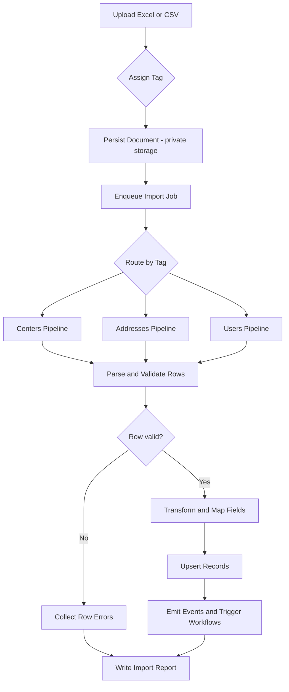

# Importing of Historical Data of Different Entities

## Description

Stakeholders provided multiple Excel/CSV files with historical data from farmers and related entities. We need a robust import capability where uploaded documents are tagged by entity and routed to the correct validation/processing pipeline. Each upload should automatically trigger the appropriate automation/workflow based on its tag, persist the original file for audit, and produce an import report for success/failure details.

Goals:
- Support document-based imports for multiple entities via tagging (e.g., centers, addresses, users/farmers, etc.).
- Trigger the correct workflow/automation pipeline per tag.
- Store the original document and capture an immutable audit trail.
- Provide clear feedback (report + notifications) for successes and failures.

## Requirements / Acceptance Criteria

- Uploading
  - User can upload one or more files (Excel .xlsx, .xls or CSV) up to a configurable size limit.
  - Each uploaded document requires an entity tag selection from allowed values (e.g., centers, addresses, users/farmers). Free-form tags are rejected.
  - On successful upload, the system stores the document in private storage and enqueues a background import job.

- Processing
  - The import job routes to a pipeline based on the entity tag.
  - Rows are validated; valid rows are imported, invalid rows are skipped without blocking the whole file.
  - Summary metrics are generated: total rows, imported, skipped, errors.
  - A per-row error report is produced (line number, column, message).
  - On completion, an Import Report entity is created and persisted, linked to the uploaded document.

- Automation/Workflow
  - After successful import, emit a domain event that triggers the workflow/automation associated with the tag.
  - Workflows can be enabled/disabled per entity via configuration.

- Storage & Auditability
  - Original documents are stored privately with metadata (uploader id, timestamp, tag, checksum).
  - Import report is persisted and downloadable.
  - All actions are audit-logged (upload, validation summary, completion status).

- UX / Feedback
  - Users can view import status: queued, processing, completed, failed.
  - If the job fails, the user sees a failure reason and can download the error report.

## Technical Specifications / Implementation Details

### Entities in current schema (for mapping)

- Users (`users`): id, name, email, email_verified_at, password, remember_token, timestamps
- Addresses (`addresses`): id, addressable_id, addressable_type, street, barangay, city, province, region, district, zip_code, country, latitude, longitude, marker_icon, timestamps
- Centers (`centers`): id, name, address_id (FK->addresses), description, timestamps

Note: Farmers domain objects are not yet defined in code; if imports target farmers, add or map to existing `users` or introduce a new `farmers` table in a separate ticket.

### Allowed file types and limits

- File types: .xlsx, .xls, .csv
- Max size: configurable (default 10 MB)

### Tagging model

- Allowed tags: `centers`, `addresses`, `users` (extendable via config e.g., `config/imports.php`).
- Tag is required and determines the routing pipeline.

### Import pipelines (initial scope)

1) Tag: `centers`
   - Required columns: name, address.street, address.city, address.province, address.region (others optional)
   - Behavior: Upsert center by unique key [name + city + province] (configurable); create/update related address record; maintain referential integrity with `address_id`.

2) Tag: `addresses`
   - Required columns: addressable_type, addressable_id, street, city, province (others optional)
   - Behavior: Upsert address by [addressable_type, addressable_id]; if not found, create; validate geo fields format.

3) Tag: `users`
   - Required columns: name, email
   - Optional: password (generated if missing), email_verified_at
   - Behavior: Upsert user by email; hash password if provided; do not overwrite password with blank.

### Validation rules (examples)

- email: valid format, unique when creating
- latitude/longitude: numeric; latitude between -90 and 90; longitude between -180 and 180
- region/province/city: non-empty for `centers` and `addresses` pipelines
- addressable_type: must be a known morph class (e.g., App\\Models\\User, App\\Models\\Center)

# Importing of Historical Data of Different Entities

## Clarifying Questions
- What are the allowed entity tags and their canonical names? For example: `centers`, `addresses`, `users` (or `farmers`?), and any others.
- Do we have standardized, canonical column templates per entity (sample files) that stakeholders will follow? If yes, where are they stored in-repo?
- Which Excel/CSV parsing approach do we prefer (streaming parser) and are there repository constraints we must follow? If undecided, shall we decide in this ticket or a follow-up?
- Which storage backend (local private vs. S3) and queue driver will be used in each environment (local, staging, prod)?
- What are the size limits, concurrency limits, and rate limits for uploads (defaults and env-based overrides)?
- Should only admins access the import UI/API, or do other roles have permission? If RBAC applies, which roles?

## Description

Stakeholders provided multiple Excel/CSV files with historical data from farmers and related entities. We need a robust import capability where uploaded documents are tagged by entity and routed to the correct validation/processing pipeline. Each upload should automatically trigger the appropriate automation/workflow based on its tag, persist the original file for audit, and produce an import report for success/failure details.

Assumptions:
- Entity-specific workflows exist or will subscribe to import completion events by tag.
- Admin-only feature initially.
- Farmers may map to `users` unless a dedicated `farmers` model/table is introduced later.

## Requirements / Acceptance Criteria / Definition of Done

Functional (Given/When/Then):
1) Given I’m an authenticated admin, When I upload a .xlsx/.xls/.csv file and select a required entity tag from allowed values, Then the original file is stored privately and an import job is enqueued.
2) Given the import job runs, When a row is valid, Then it is upserted into the correct tables; When a row is invalid, Then it is skipped and captured in the error report without failing the whole file.
3) Given the import completes, Then the system generates an Import Report with totals (rows/imported/skipped/errors) and per-row errors (line, column, message) and persists it for download.
4) Given the import completes successfully, Then a domain event is emitted that triggers the workflow(s) associated with the tag; When workflows are disabled for the tag, Then the event is emitted but no workflows run.
5) Given a file with a disallowed tag, When I submit the upload, Then I receive a 422 validation error with a helpful message and no file is processed.
6) Given a file exceeds the configured max size or has an invalid MIME/signature, When I upload, Then the request is rejected with a descriptive error and nothing is enqueued.
7) Given a duplicate upload (same checksum/idempotency key), When I attempt to upload again, Then the system prevents reprocessing and surfaces a helpful message.
8) Given I open the imports page, When a job is in progress, Then I see status (queued/processing/completed/failed) and can download the final report after completion.

Non-functional:
- Security: Auth required; CSRF protection; authorization restricted to allowed roles; private file storage only; strict MIME/signature checks.
- Performance: Streaming parse with chunking (e.g., 500 rows); backoff retries for transient failures; timeouts configurable; memory-safe processing.
- Auditability: Log upload, parse summary, completion status, and workflow triggers with correlation IDs.
- Reliability: Idempotency per upload via checksum.

## Technical Specifications / Implementation Details / Scope of Work

### Entities in current schema (for mapping)
- Users (`users`): id, name, email, email_verified_at, password, remember_token, timestamps
- Addresses (`addresses`): id, addressable_id, addressable_type, street, barangay, city, province, region, district, zip_code, country, latitude, longitude, marker_icon, timestamps
- Centers (`centers`): id, name, address_id (FK->addresses), description, timestamps

Note: Farmers are not yet a distinct model. If needed, create a separate ticket to introduce `farmers` and update mappings.

### Allowed file types and limits
- File types: .xlsx, .xls, .csv
- Max size: configurable (default 10 MB)

### Tagging model
- Allowed tags (initial): `centers`, `addresses`, `users` (extendable via configuration, e.g., `config/imports.php`).
- Tag is required and determines the routing pipeline.

### Import pipelines (initial scope)
1) Tag: `centers`
   - Required columns: name, address.street, address.city, address.province, address.region (others optional)
   - Behavior: Upsert center by unique key [name + city + province] (configurable); create/update related address; maintain referential integrity via `address_id`.

2) Tag: `addresses`
   - Required columns: addressable_type, addressable_id, street, city, province (others optional)
   - Behavior: Upsert address by [addressable_type, addressable_id]; create if missing; validate geo fields format.

3) Tag: `users`
   - Required columns: name, email
   - Optional: password (generate if missing), email_verified_at
   - Behavior: Upsert user by email; hash password if provided; never overwrite password with blank.

### Validation rules (examples)
- email: valid format, unique when creating
- latitude/longitude: numeric; latitude between -90 and 90; longitude between -180 and 180
- region/province/city: non-empty for `centers` and `addresses`
- addressable_type: must be a known morph class (e.g., App\\Models\\User, App\\Models\\Center)

### Processing architecture
- On upload:
  - Persist Document: private disk (e.g., storage/app/private/imports/{uuid}.{ext})
  - Save metadata: uploader_id, tag, checksum (SHA-256), original_filename
  - Dispatch ImportJob with document id

- ImportJob:
  - Route by tag to specific handler (e.g., CentersImportHandler, AddressesImportHandler, UsersImportHandler)
  - Stream-parse file to avoid memory spikes; process in chunks (e.g., 500 rows)
  - Collect row-level errors while continuing processing
  - Generate ImportReport (JSON + CSV of errors)
  - Emit event ImportCompleted(tag, document_id, stats)

- Automation:
  - Subscribe workflows/automations to ImportCompleted events filtered by tag
  - Map tag -> workflow handlers via configuration

### UX / API surfaces (suggested)
- Web UI:
  - Upload form: file input(s), required tag select
  - Import list/detail pages showing status and downloadable report

- API endpoints:
  - POST /imports { file(s), tag }
  - GET /imports (list)
  - GET /imports/{id} (status + report)

### Security & compliance
- Private disk storage only; no public URLs
- Validate MIME types and file signatures
- CSRF protection for upload forms; auth required; role-based authorization
- Rate limit uploads; per-user quotas configurable

### Performance & reliability
- Background jobs using Laravel queue; retry with backoff on transient errors
- Streaming readers for large files
- Idempotency key per upload (checksum) to prevent double-processing

### Example workflow diagram

## Risk Assessment / Mitigation / Dependencies / Blockers / Assumptions

- Risks
  - Non-standard column headers and data formats across stakeholder files
  - Very large files causing memory/timeouts if not streamed
  - Incorrect tags leading to misrouted processing

- Dependencies
  - Laravel queue configured and running
  - Private file storage configured (e.g., local, S3)
  - Excel/CSV streaming parser (to be selected in-repo; no external link required)

- Blockers
  - Missing canonical column templates per entity
  - Undefined farmer domain model if distinct from users

- Assumptions
  - Entity-specific workflows already exist or will be wired to ImportCompleted events
  - Admin-only feature initially

## Additional Notes / References / Resources / Links
- Related code: migrations in `database/migrations` (current schema)
- Consider adding `config/imports.php` to manage allowed tags, pipelines, and workflow handlers
- Consider a follow-up ticket to define a `farmers` model/table and its import mapping if required
