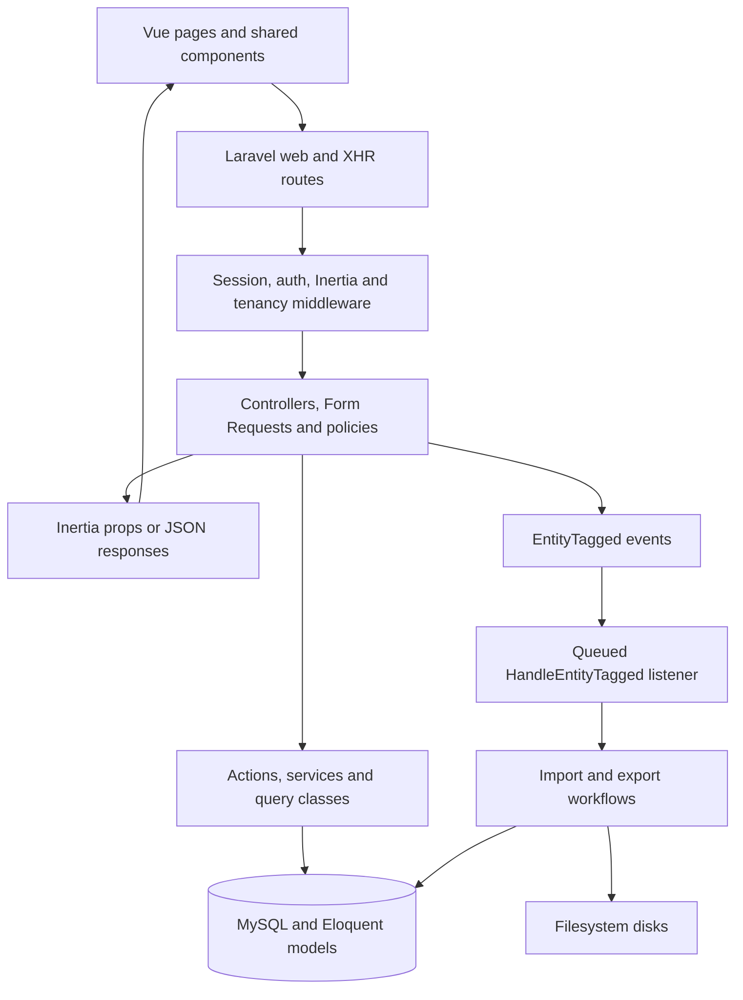

# SUPREME CBED

SUPREME CBED is a Philippine Carabao Center (PCC) application for profiling institutional herds and carabao-based enterprises, recording operational data, and monitoring program performance. It brings center, partner, and farmer records together with production, sales, services, document review, and reporting.

The application serves PCC administrators, executives, center administrators, encoders, and reviewers. Its main program views are **Institutional Herd (IH)** and **Carabao-Based Enterprise Development (CBED)**; project records also cover programs such as CBIN, CCDP, and milk feeding.

This guide describes the implementation in this repository. Routes, pages, and tests exist for the modules below; their presence does not establish production readiness or a passing test suite. Historical design documents can describe earlier behavior, so consult the linked source and tests when making changes.

## Contents

- [Technology stack](#technology-stack)
- [Architecture overview](#architecture-overview)
- [Project directory structure](#project-directory-structure)
- [Core features and modules](#core-features-and-modules)
- [Database and data management](#database-and-data-management)
- [Installation and local development](#installation-and-local-development)
- [Configuration](#configuration)
- [Development workflow and conventions](#development-workflow-and-conventions)
- [Testing](#testing)
- [Deployment overview](#deployment-overview)
- [Troubleshooting](#troubleshooting)
- [Additional documentation](#additional-documentation)
- [Verification limits and known gaps](#verification-limits-and-known-gaps)

## Technology stack

Versions below are recorded in [composer.lock](composer.lock) and [package-lock.json](package-lock.json). Runtime requirements are discussed under installation.

| Area                    | Implementation                                                                                                              |
| ----------------------- | --------------------------------------------------------------------------------------------------------------------------- |
| Backend                 | PHP; Laravel 12.34.0; Eloquent models and migrations                                                                        |
| Frontend                | Vue 3.5.22 single-file components, primarily JavaScript; some shared components use TypeScript syntax                       |
| Page integration        | Inertia Laravel 2.0.10 and Inertia Vue 2.2.9; Ziggy exposes named Laravel routes to Vue                                     |
| Styling and UI          | Tailwind CSS 4.1.17, shadcn-vue components, Reka UI 2.9.2, Lucide icons, Vue Sonner notifications                           |
| Tables, charts, maps    | TanStack Vue Table, Unovis, Leaflet 1.9.4 and Vue Leaflet; OpenStreetMap tiles and local GeoJSON assets                     |
| State                   | Vue refs/computed values, composables, Inertia page props and forms; Laravel sessions retain selected filters/program views |
| Authentication          | Laravel session authentication with Breeze-derived screens; role/permission checks use Spatie Laravel Permission 6.21.0     |
| Database                | MySQL 8.0 in Compose; shared tables with agency/center associations and application-level access checks                     |
| Files                   | Local filesystem disks for uploads, media, and generated documents; Compose also includes MinIO                             |
| Imports and exports     | Laravel Excel 3.1.67, PhpSpreadsheet, CSV utilities, mPDF, Spatie Laravel PDF 1.8.0 and Browsershot/Puppeteer               |
| Background work         | Laravel events and queued listeners; database queue by default; Redis is available in Compose                               |
| Audit history           | Spatie Laravel Activitylog 4.12.3 and shared model concerns                                                                 |
| Tests and quality tools | PHPUnit 11.5.42, Laravel Pint, Rector, ESLint, Prettier, Stylelint                                                          |
| Build and development   | Vite 7.1.11, npm, Composer, Laravel Sail; custom PHP 8.4 / Node 22 Docker image                                             |

See [composer.json](composer.json) and [package.json](package.json) for direct dependencies and scripts. A package being installed does not mean every feature uses it; normal browser authentication follows session-based routes.

## Architecture overview

This is a Laravel application with an Inertia-connected Vue frontend, organized by domain across controllers, actions, query classes, services, and models. The PHP and Vue code live in the same repository and share Laravel route names.



A typical page request follows this path:

1. [routes/web.php](routes/web.php) selects a controller. [bootstrap/app.php](bootstrap/app.php) registers routing and the web middleware pipeline.
2. Middleware shares the signed-in user, permissions, tenant context, flash messages, and selected program. Policies and Form Requests enforce access and validate input where wired into the feature.
3. Controllers coordinate reads and writes. `app/Actions/` contains reusable operations; `app/Queries/` contains reporting/aggregation queries; `app/Services/` coordinates broader behavior such as account provisioning and report catalogs. Resource listings commonly use Spatie Query Builder for allowed filters and sorts.
4. An `Inertia::render('Module/Page', ...)` response resolves to `resources/js/Pages/Module/Page.vue` through [resources/js/app.js](resources/js/app.js). Vue renders inside shared layouts; `useForm` submits forms back to named Laravel routes.
5. Some interactions use authenticated `/xhr/*` JSON endpoints, including dashboard metrics, uploads, and document status polling. Root HTML comes from [resources/views/app.blade.php](resources/views/app.blade.php).

For background processing, [EntityTagged](app/Events/EntityTagged.php) is handled by [HandleEntityTagged](app/Listeners/HandleEntityTagged.php), a queued listener that selects an import/export workflow using document tags. Workflows call imports, exports, and supporting actions, and update document status and audit history. Keeping a queue worker running is necessary for this flow.

## Project directory structure

```text
.
├── app/
│   ├── Actions/                 # Domain operations, grouped by feature
│   ├── Concerns/                # Shared workflow/queue and reporting behavior
│   ├── Console/Commands/        # Maintenance, import support and utility commands
│   ├── Enums/                  # Domain values, labels and selectable options
│   ├── Events/                 # Events such as EntityTagged
│   ├── Exports/                # Spreadsheet/report output classes
│   ├── Http/
│   │   ├── Controllers/        # Inertia pages, resource actions and Xhr endpoints
│   │   ├── Middleware/         # Shared props, tenant context and program selection
│   │   └── Requests/           # Input validation and request authorization
│   ├── Imports/                # Spreadsheet ingestion and row mapping
│   ├── Listeners/              # Queued event handlers
│   ├── Models/                 # Eloquent entities and reusable model concerns
│   ├── Policies/               # Resource authorization and scope checks
│   ├── Providers/              # Bootstrapping, morph map and model hooks
│   ├── Queries/                # Read queries and report aggregations
│   ├── Services/               # Provisioning, project-site and reporting services
│   ├── Support/                # Tenancy, filters, registries and calculations
│   └── Workflows/              # Import/export orchestration
├── bootstrap/app.php           # Application routing and middleware configuration
├── config/                     # Framework and domain configuration
├── database/
│   ├── factories/              # Model factories; some retain legacy fields
│   ├── migrations/             # Current schema, views and incremental changes
│   └── seeders/                # Permissions, geography, sample and roster seeders
├── resources/
│   ├── css/app.css             # Tailwind entry point and theme
│   ├── js/
│   │   ├── Pages/              # Inertia pages and feature-specific Partials
│   │   ├── Layouts/            # Dashboard, authenticated, guest and map layouts
│   │   ├── components/         # Shared forms, tables, dialogs, maps and ui primitives
│   │   ├── composable/         # Shared Vue logic, including useAuth.js
│   │   ├── enums/              # Frontend enum values and labels
│   │   ├── lib/                # Navigation, document helpers and shared utilities
│   │   ├── utils/              # Additional utilities, including GeoJSON loading
│   │   └── app.js              # Vue/Inertia initialization
│   ├── psgc/                   # Philippine geographic reference JSON
│   └── views/                  # Root Blade template and PDF templates
├── public/                     # Web root and static assets, including GeoJSON
├── routes/                     # Web, authentication and scheduled command routes
├── tests/                      # PHPUnit Feature and Unit suites
├── docker/                     # Custom Sail runtime and MySQL test DB initialization
├── scripts/                    # MinIO initialization helper
├── docs/plans/                 # Historical implementation plans
├── .github/                    # CI workflows, contributor guidance and issue context
├── compose.yaml                # Local container services
├── composer.json               # PHP dependencies and development/test scripts
├── package.json                # Frontend dependencies and quality/build scripts
└── phpunit.xml                 # Test suites and testing environment overrides
```

## Core features and modules

| Module                     | Responsibilities and data                                                                                                              | Starting points                                                                                                                                                                                                                                                                                                                                                         |
| -------------------------- | -------------------------------------------------------------------------------------------------------------------------------------- | ----------------------------------------------------------------------------------------------------------------------------------------------------------------------------------------------------------------------------------------------------------------------------------------------------------------------------------------------------------------------- |
| Dashboard and map          | Program/year/month/center filters, production metrics, charts, center locations and coverage                                           | [DashboardController](app/Http/Controllers/DashboardController.php), [Dashboard.vue](resources/js/Pages/Dashboard.vue), [CBEDMap.vue](resources/js/components/CBEDMap.vue), `app/Http/Controllers/Xhr/`                                                                                                                                                                 |
| Profiles                   | Agency, Center, Partner, Farmer and Herd records; addresses, affiliations and value-chain units; unified profile listing               | [ProfilesController](app/Http/Controllers/ProfilesController.php), [CenterController](app/Http/Controllers/CenterController.php), [PartnerController](app/Http/Controllers/PartnerController.php), [FarmerController](app/Http/Controllers/FarmerController.php), `resources/js/Pages/Profiles/`                                                                        |
| Production and sales       | Milk production and related sales, costs, usage, wastage and trading; meat/manure production and sales; production/sales goals         | [MilkProductionController](app/Http/Controllers/MilkProductionController.php), `app/Actions/MilkProduction/`, `app/Queries/Reports/`, corresponding production/sales models and Vue pages                                                                                                                                                                               |
| Programs and projects      | Projects and project sites, CBIN/CCDP site forms, dairy boxes, milk feeding, PL480 and EPAHP records                                   | [ProjectSiteRelationsService](app/Services/ProjectSiteRelationsService.php), [CBINProjectSiteController](app/Http/Controllers/CBINProjectSiteController.php), [CCDPProjectSiteController](app/Http/Controllers/CCDPProjectSiteController.php), [PL480Controller](app/Http/Controllers/PL480Controller.php), [EpahpController](app/Http/Controllers/EpahpController.php) |
| Services and support       | Services delivered, service records, production support, market development, IEC and ESET records associated with operational entities | [ServiceController](app/Http/Controllers/ServiceController.php), [ServiceRecordController](app/Http/Controllers/ServiceRecordController.php), related models and `resources/js/Pages/Services/`                                                                                                                                                                         |
| Documents and imports      | File upload, ownership, submission, center/agency review, rejection/resubmission, import processing and status/details views           | [DocumentController](app/Http/Controllers/DocumentController.php), [Document](app/Models/Document.php), [DocumentOwnershipResolver](app/Support/Documents/DocumentOwnershipResolver.php), `app/Workflows/`, `app/Imports/`, `resources/js/Pages/Documents/`                                                                                                             |
| Reports and exports        | Buffalo-derived products summaries, directories, milk utilization, report templates, pivot fields and queued downloads                 | [GenerateReportController](app/Http/Controllers/GenerateReportController.php), [PivotBuilderService](app/Services/PivotBuilderService.php), [ReportCatalogService](app/Services/Reports/ReportCatalogService.php), [MilkUtilizationCalculator](app/Support/MilkUtilizationCalculator.php), `app/Exports/`, `resources/js/Pages/Reports/`                                |
| Monthly tasks              | Generate reporting tasks, record submissions, approve/return figures, reminders, history and completion/totals reports                 | [MonthlyTaskController](app/Http/Controllers/MonthlyTaskController.php), [MonthlyTask](app/Models/MonthlyTask.php), `app/Actions/MonthlyTask/`, `app/Queries/MonthlyTask/`, `resources/js/Pages/MonthlyTasks/`                                                                                                                                                          |
| Accounts and audit history | User provisioning, activation/rejection/deactivation/reactivation, roles, profile/password changes, and attributable change history    | [UserProvisioningService](app/Services/UserProvisioningService.php), [UserPolicy](app/Policies/UserPolicy.php), [AuditController](app/Http/Controllers/AuditController.php), [LogsAuditTrail](app/Models/Concerns/LogsAuditTrail.php), `resources/js/Pages/Users/`, `resources/js/Pages/Profile/`                                                                       |

### Document review and processing

For a document associated with a center, the current submission path is:

```text
draft → pending_center_review → pending_agency_review → approved → processing → processed
```

A center-less document enters agency review directly. Authorized reviewers can reject at their stage, producing `rejected_by_center` or `rejected_by_agency`; editable rejected documents can be resubmitted. Processing failures use `failed`. Legacy status values remain in [DocumentStatusEnum](app/Enums/DocumentStatusEnum.php), so use its helpers and the controller's stage rules when extending this workflow.

Agency approval starts processing through the event/listener chain. Submission versions and [DocumentImportDispatch](app/Models/DocumentImportDispatch.php) support claiming approved imports without processing the same submission repeatedly. Review history and import status are separate from the original uploaded file.

Monthly-task review is a separate workflow. Production/sales model hooks in [AppServiceProvider](app/Providers/AppServiceProvider.php) synchronize submissions; saving figures does not itself approve a task. See [MonthlyTaskStatusEnum](app/Enums/MonthlyTaskStatusEnum.php) and [ReviewTaskAction](app/Actions/MonthlyTask/ReviewTaskAction.php).

## Database and data management

### Main entities and relationships

The original core hierarchy remains useful as an orientation:

```text
Agency → Centers → Partners → Farmers
```

It is not the complete schema. Farmers also have a direct center association, and many operational records carry center, partner, or farmer ownership independently.

| Entities/tables                                            | Relationship and purpose                                                                                                                                                                   |
| ---------------------------------------------------------- | ------------------------------------------------------------------------------------------------------------------------------------------------------------------------------------------ |
| `agencies`, `centers`                                      | An agency has many centers. Current identifiers use `code`; names and descriptions provide display/context.                                                                                |
| `partners`, `farmers`, `herds`                             | Profiles and herd records associate operational activity with centers and partners. Consult model relationships for the relevant ownership path.                                           |
| `addresses`                                                | Polymorphic `addressable_type` / `addressable_id` links an address to entities such as Agency, Center, Partner and Farmer. Geography and coordinates support forms, filtering and mapping. |
| `projects`, `project_sites`, association tables            | Projects link to centers, partners and farmers; project sites also carry infrastructure and other domain details.                                                                          |
| Production, sales and goals tables                         | Milk/meat/manure records and goals store program, period and ownership data. Counts, money and volumes have domain-specific casts and precision; use migrations as the field reference.    |
| `documents`, `files`, `tags`, `document_import_dispatches` | Uploaded/generated files, document classification, review/processing metadata and import dispatch bookkeeping.                                                                             |
| `users`, roles and permissions                             | Accounts associate with agencies and optionally centers; permissions are synchronized from `config/roles.php`.                                                                             |
| `monthly_tasks`, `activity_log`                            | Reporting obligations and review state; audit events and changed attributes.                                                                                                               |
| Geographic reference tables                                | Regions, provinces, cities, barangays and districts loaded from `resources/psgc/`.                                                                                                         |
| `profiles`                                                 | A SQL view combining center, partner and farmer profile data, created by a migration.                                                                                                      |

The schema is defined by [database/migrations](database/migrations), rather than the legacy entity field lists in older documents. Polymorphic aliases are registered in [AppServiceProvider](app/Providers/AppServiceProvider.php); keep those aliases consistent with stored data.

### Access and data isolation

Data shares one database. Authorization combines role permissions, agency/center ownership, policies, request checks and explicitly applied query scopes. [EnsureTenancyScope](app/Http/Middleware/EnsureTenancyScope.php) exposes [TenantContext](app/Support/Tenancy/TenantContext.php); it does not automatically filter every SQL query.

- PCC Administrator (`agency-admin`) and Executive (`executive`) operate at agency level; the Executive has reporting/export capabilities without data-entry or account-management permissions.
- Center Admin (`center-admin`) requires a center. Encoder (`encoder`) and Reviewer (`reviewer`) can be assigned to a center or provisioned agency-wide without one.
- Use the account-level helpers on [User](app/Models/User.php), including `isCenterScoped()`, `isPccLevel()`, `canExportData()` and `canExportOwnCenter()`. Scope depends on both the role and the account's center assignment.
- [ScopedToCenter](app/Models/Concerns/ScopedToCenter.php), [HasScopeAccess](app/Policies/Concerns/HasScopeAccess.php), and [ForcesCenterForCenterScopedUser](app/Http/Requests/Concerns/ForcesCenterForCenterScopedUser.php) provide reusable protections. Raw report queries also need their scope applied explicitly.
- `ProgramEnum` represents IH/CBED views; `ProjectProgramEnum` represents project programs. Preserve this distinction when adding filters or imports.

UI visibility comes from shared permissions and [useAuth.js](resources/js/composable/useAuth.js). Server authorization remains necessary on every read, write and export path.

### Migrations, seeders and resets

[DatabaseSeeder](database/seeders/DatabaseSeeder.php) chooses different paths by environment. Its non-production path invokes sample Agency/Center/Partner/Farmer seeders; several of these and older factories still use removed fields such as `agency_code`, `center_code` or `slug`. **Do not use `migrate --seed` as the fresh-install path described here.** Production seeders contain a separate roster/account provisioning path and should be reviewed before use.

Use the explicit permission and geography steps below for local onboarding. `RolesPermissionsSeeder` synchronizes permissions from configuration. `PSGCSeeder` loads the included reference JSON, including districts, and normally truncates reference tables; the setup command disables truncation for an upsert-based import.

To reset a **disposable local database**, run `php artisan migrate:fresh`, then repeat permission/geography seeding and local account creation. This removes its tables and data. Keep the test database separate.

## Installation and local development

These commands are checked against repository scripts and source. A complete clean-machine installation was not executed for this documentation update.

### 1. Prerequisites and checkout

- PHP 8.4 matches the Docker image and PHP CI configuration. `composer.json` declares PHP `^8.2`; the lockfile and enabled extensions determine installation compatibility.
- Composer with the extensions required by the lockfile. The runtime includes PDO MySQL, mbstring, XML/DOM, ZIP, GD, BCMath, cURL and Intl; `composer check-platform-reqs` reports the complete installed requirements.
- Node.js **22.12 or later in the Node 22 line**, with npm, is a suitable baseline. Locked Vite requires `^20.19.0 || >=22.12.0`.
- MySQL 8.0 and a local database user with access to the development and `testing` databases.
- A Chrome/Chromium installation usable by Puppeteer for PDF features. Docker is optional for the container workflow below.

Replace `<repository-url>` with the repository's clone URL:

```bash
git clone <repository-url> supreme-cbed-poc
cd supreme-cbed-poc
cp .env.example .env
composer install
npm ci
composer check-platform-reqs
```

Use the committed lockfiles. Dependency installation may download browser assets through Puppeteer; no dependencies need updating to start development.

### 2. Configure MySQL and the environment

Create development and test databases using an administrative MySQL connection:

```sql
CREATE DATABASE supreme_cbed CHARACTER SET utf8mb4 COLLATE utf8mb4_unicode_ci;
CREATE DATABASE testing CHARACTER SET utf8mb4 COLLATE utf8mb4_unicode_ci;
CREATE USER '<local-database-user>'@'localhost' IDENTIFIED BY '<local-database-password>';
GRANT ALL PRIVILEGES ON supreme_cbed.* TO '<local-database-user>'@'localhost';
GRANT ALL PRIVILEGES ON testing.* TO '<local-database-user>'@'localhost';
```

Replace the user/password placeholders before running the SQL; if you already have a development account, grant that account access to both databases instead of creating another one. Replace the connection placeholders in `.env`:

```dotenv
APP_NAME="SUPREME CBED"
APP_ENV=local
APP_DEBUG=true
APP_URL=http://localhost:8000

DB_CONNECTION=mysql
DB_HOST=127.0.0.1
DB_PORT=3306
DB_DATABASE=supreme_cbed
DB_USERNAME=<local-database-user>
DB_PASSWORD=<local-database-password>

SESSION_DRIVER=database
CACHE_STORE=database
QUEUE_CONNECTION=database
FILESYSTEM_DISK=local
MAIL_MAILER=log
```

Although `.env.example` defaults to SQLite, the application uses MySQL-specific SQL, including the `profiles` view and aggregation functions. Use MySQL for this setup and the test suite.

### 3. Initialize schema, permissions and local storage

```bash
php artisan key:generate
php artisan config:clear
php artisan migrate
php artisan db:seed --class=RolesPermissionsSeeder
php artisan storage:link
```

Populate geographic selectors from the repository's JSON without truncating the reference tables:

```bash
php artisan tinker --execute="config(['psgc.truncate_before_seed' => false]); app(\Database\Seeders\PSGCSeeder::class)->run();"
```

The `media` and `dpm` disks are local directories under `storage/app/public`; the storage link makes their URLs available. The PHP process needs write access to `storage/` and `bootstrap/cache/`.

### 4. Bootstrap the first local administrator

Public registration routes are disabled in [routes/auth.php](routes/auth.php), and the default development seed path does not create a usable administrator. On a new local database, open Tinker:

```bash
php artisan tinker
```

Run this PHP snippet. The password is entered interactively, and the existing provisioning service applies hashing, role assignment and active-status bookkeeping:

```php
$agency = \App\Models\Agency::firstOrCreate(
    ['code' => 'LOCAL-PCC'],
    ['name' => 'Local PCC Development']
);

$admin = app(\App\Services\UserProvisioningService::class)->create(
    name: 'Local Administrator',
    email: 'local-admin@example.test',
    username: 'local_admin',
    password: \Laravel\Prompts\password('Choose a local administrator password', required: true),
    role: \App\Enums\UserRoleEnum::AGENCY_ADMIN,
    status: \App\Enums\UserStatusEnum::ACTIVE,
    agency: $agency,
);
```

Exit Tinker and sign in using the email or username and the password you chose. This deliberately creates the first **local** account as active. Subsequent accounts should use the Users/center-management flows: new accounts normally await approval, and pending/rejected/deactivated accounts cannot sign in. [UserPolicy](app/Policies/UserPolicy.php) also prevents an account from approving itself.

The fresh setup has reference data and one administrator, rather than a full sample dataset. Create operational records through the UI or use reviewed fixtures for the feature you are developing.

### 5. Start development services

```bash
composer run dev
```

The Composer script starts the PHP development server, a queue listener, Laravel Pail logs and Vite concurrently. Open `http://localhost:8000`.

You can also run each process in a separate terminal:

```bash
php artisan serve
```

```bash
npm run dev
```

```bash
php artisan queue:listen --tries=1
```

For scheduled work, run `php artisan schedule:work` in another terminal. [routes/console.php](routes/console.php) schedules daily storage cleanup; review retention settings before enabling it against valuable files. Large imports may need a longer worker timeout; [queue-listen.bat](queue-listen.bat) records an existing long-running-worker configuration, but its executable paths are machine-specific.

### 6. Optional Docker / Sail workflow

[compose.yaml](compose.yaml) defines the PHP application, MySQL 8.0, Redis, Mailpit, MinIO and Traefik. After dependency installation, adapt `.env` for the container network:

```dotenv
APP_PORT=8080
APP_URL=http://localhost:8080
DB_HOST=mysql
DB_PORT=3306
REDIS_HOST=redis
MAIL_MAILER=smtp
MAIL_HOST=mailpit
MAIL_PORT=1025
AWS_ACCESS_KEY_ID=<local-minio-access-key>
AWS_SECRET_ACCESS_KEY=<local-minio-secret-key>
```

Keep the database name/user/password configured for development; Compose uses those variables to initialize MySQL. Set MinIO credentials to locally chosen values meeting MinIO's requirements. They are needed by the service even though the application's current upload disks are local.

```bash
./vendor/bin/sail up -d
./vendor/bin/sail artisan key:generate
./vendor/bin/sail artisan migrate
./vendor/bin/sail artisan db:seed --class=RolesPermissionsSeeder
./vendor/bin/sail artisan storage:link
./vendor/bin/sail npm ci
```

Run the geography command and administrator snippet from steps 3–4 through `./vendor/bin/sail artisan tinker`. Start Vite with `./vendor/bin/sail npm run dev -- --host 0.0.0.0` and the queue with `./vendor/bin/sail artisan queue:listen --tries=1` in separate terminals. The application is available at the configured `APP_PORT`.

The MySQL initialization script creates `testing` and grants the configured user access when the database volume is first initialized. Existing volumes do not rerun that script. See [docker/mysql/create-testing-database.sh](docker/mysql/create-testing-database.sh).

The custom image downloads an ARM64 Chromium build unconditionally. Compatibility of that browser step on other architectures has not been verified. [scripts/minio-init.sh](scripts/minio-init.sh) is mounted into MinIO but is not invoked by its Compose command; bucket initialization is not automatic, and the helper includes a public-download policy. Review it before using MinIO for application data.

### 7. Run checks and create a production asset build

After setting up the separate MySQL test database, run `composer test`. See [Testing](#testing) for focused runs and environment isolation.

```bash
npm run build
```

Vite writes the asset manifest and compiled files to `public/build/`. A production asset build does not start PHP, a queue worker or the scheduler.

## Configuration

| Configuration                                                                                                                              | Purpose                                                                                                                                                                                           |
| ------------------------------------------------------------------------------------------------------------------------------------------ | ------------------------------------------------------------------------------------------------------------------------------------------------------------------------------------------------- |
| `.env.example`, [config/app.php](config/app.php)                                                                                           | `APP_NAME`, `APP_ENV`, `APP_KEY`, `APP_DEBUG` and `APP_URL`; `VITE_APP_NAME` supplies the browser title suffix.                                                                                   |
| [config/database.php](config/database.php)                                                                                                 | `DB_CONNECTION`, `DB_HOST`, `DB_PORT`, `DB_DATABASE`, `DB_USERNAME`, `DB_PASSWORD`; MySQL connection and Redis endpoints.                                                                         |
| [config/roles.php](config/roles.php), [UserRoleEnum](app/Enums/UserRoleEnum.php)                                                           | Stored role values, labels and permission membership. Run `php artisan db:seed --class=RolesPermissionsSeeder` after approved permission changes.                                                 |
| [config/filesystems.php](config/filesystems.php)                                                                                           | `FILESYSTEM_DISK` and named local disks: private `local`, public `public`, `media`, and `dpm`. AWS variables alone do not define an S3 upload disk in this file.                                  |
| [config/documents.php](config/documents.php)                                                                                               | Upload extension/MIME allowlist and 20 MB application limit. Allowed extensions are PDF, XLSX, XLS and CSV; processing depends on the selected template.                                          |
| [config/queue.php](config/queue.php)                                                                                                       | `QUEUE_CONNECTION`; the database connection's `DB_QUEUE_RETRY_AFTER` defaults to 7200 seconds. Set worker timeout below the relevant retry interval.                                              |
| [config/session.php](config/session.php), [config/cache.php](config/cache.php)                                                             | `SESSION_DRIVER`, `SESSION_LIFETIME`, `CACHE_STORE`; examples use database-backed sessions/cache.                                                                                                 |
| [config/mail.php](config/mail.php)                                                                                                         | `MAIL_MAILER` and SMTP variables; local host setup logs mail, while Compose provides Mailpit.                                                                                                     |
| [config/psgc.php](config/psgc.php)                                                                                                         | Geographic table names, package route prefix, JSON location and reference-data truncation behavior.                                                                                               |
| [config/reports.php](config/reports.php), [config/template.php](config/template.php), [config/pivot_sources.php](config/pivot_sources.php) | Report definitions, filters, output templates and pivot source metadata.                                                                                                                          |
| [config/milk_utilization.php](config/milk_utilization.php)                                                                                 | Report columns, formulas, source availability and unit/conversion notes. Some measures have unresolved source or conversion rules; preserve these notes when changing calculations.               |
| [config/browsershot.php](config/browsershot.php), [BrowserShotEnvironmentService](app/Services/BrowserShotEnvironmentService.php)          | Node/npm and browser discovery for PDF generation. `NODE_PATH` / `NPM_PATH` are read by configuration; inspect the specific PDF path because the service also performs its own runtime discovery. |
| [config/geocoder.php](config/geocoder.php)                                                                                                 | Optional Google Maps geocoding key and Redis-backed geocode cache. This is separate from the Leaflet/OpenStreetMap dashboard map.                                                                 |
| [config/storage_cleanup.php](config/storage_cleanup.php)                                                                                   | `STORAGE_CLEANUP_DISK`, comma-separated `STORAGE_CLEANUP_PATH`, and `STORAGE_CLEANUP_RETENTION_DAYS`; default cleanup targets public `dpm/exports,dpm/files` after 30 days.                       |

Use placeholders in shared configuration examples and keep real connection values in local/deployment environment configuration. Run `php artisan config:clear` after changing local environment values. Vite-exposed environment variables become browser-visible; keep credentials out of them.

## Development workflow and conventions

### Extending a feature

Existing organization and contributor guidance favor these steps:

1. Locate the route, controller, policy/Form Requests, domain action/query, page and related tests before editing. Follow the neighboring feature's naming and response shape.
2. Add input validation in `app/Http/Requests/` and enforce the capability and ownership on the server. Scope list, detail, mutation and export paths; a selected filter or hidden navigation item is not an authorization check.
3. Put reusable writes in domain-specific action classes with typed `execute(...)` parameters. Use services for coordination and query classes for reporting reads. These are repository guidelines; existing controllers also contain coordination and domain logic.
4. Reuse `resources/js/components/` and `components/ui/`, feature `Partials/`, and `resources/js/composable/`. New pages use Vue `<script setup>` and Inertia forms. The `@/` alias resolves to `resources/js/`; route names come from Ziggy.
5. Maintain corresponding PHP/frontend enum values when a feature has a frontend mirror. Shared props belong in `HandleInertiaRequests`; navigation definitions live in `resources/js/lib/navLinks.js`.
6. Add an incremental migration for schema changes; check existing foreign keys, unique indexes, casts, morph aliases, import mappings and exports before renaming fields.
7. Add or update relevant behavior tests, including account scope and export ownership where applicable. For document work, test review stages and duplicate processing; for report work, verify units and totals.

For map UI, keep Leaflet panes, controls and custom legends within the map's stacking context. The dashboard map root uses `isolate` so its internal z-index values stay below page dialogs. The account-settings dialog keeps its header visible and scrolls its form body; preserve keyboard/focus behavior and check small viewports when changing it.

### Quality commands and CI

| Command                                                   | Purpose                                                                                              |
| --------------------------------------------------------- | ---------------------------------------------------------------------------------------------------- |
| `npm run lint` / `npm run lint:fix`                       | ESLint checks/fixes JavaScript and Vue source. Shared `components/ui/` is excluded by configuration. |
| `npm run format:check` / `npm run format`                 | Prettier checks/formats frontend JS/Vue and CSS using `.prettierrc` and `.prettierignore`.           |
| `npm run style:lint` / `npm run style:fix`                | Stylelint checks/fixes CSS.                                                                          |
| `./vendor/bin/pint --test` / `./vendor/bin/pint`          | Check/apply PHP formatting.                                                                          |
| `./vendor/bin/rector process --dry-run --no-progress-bar` | Preview configured Rector findings without rewriting PHP.                                            |
| `npm run build`                                           | Compile frontend assets and Vue components.                                                          |
| `composer test`                                           | Clear cached configuration and run the PHP suite.                                                    |

Prettier uses two spaces, single quotes, no semicolons, a 100-character line width and Tailwind class sorting. JavaScript is the preferred language in the contributor guidance; existing UI primitives contain TypeScript, but there is no dedicated type-check script in `package.json`.

The current CI runs Pint on pushes and can commit formatting changes; Rector runs on pull requests. Context validation is a placeholder workflow, and the AI review workflow references Node 14 and an absent `src/index.js` entry point. There is no PHPUnit or frontend build/test job in the checked-in workflows, so do the relevant local checks and report their actual results.

[PR guidelines](.github/instructions/pr-guidelines.instructions.md) ask for focused changes, a problem/approach description, linked issues, test/manual-check details and at least two reviewers. No branch naming convention is specified there.

### Code discovery for assistants

When `codebase-memory-mcp` is available, follow the project instructions: prefer `search_graph`, `trace_path`, `get_code_snippet`, `query_graph` and `get_architecture` for discovery. Index the repository first if it is not indexed. Graph-augmented `search_code` can find implementation text; fall back to direct search for literals, non-code configuration or incomplete graph results. Verify findings against the working tree when the index is stale.

## Testing

[phpunit.xml](phpunit.xml) defines **Unit** and **Feature** suites. Tests cover account/role access, documents and review, monthly tasks, center ownership, audit trails, reports/exports, registry parsing and calculations. Many feature tests use `RefreshDatabase`; some unit tests also boot Laravel, so the test environment still matters.

Use a dedicated MySQL database named **`testing`**, with the development database kept separate. PHPUnit configures `APP_ENV=testing`, `DB_DATABASE=testing`, array cache/mail/session drivers and a synchronous queue. It does not set `DB_CONNECTION`, so ensure MySQL is selected. The application has a database-name guard in `AppServiceProvider`, and `DatabaseIsolationTest` asserts the active database is `testing`.

```bash
composer test
```

For a focused run, clear cached configuration and explicitly select the test connection/database:

```bash
php artisan config:clear
DB_CONNECTION=mysql DB_DATABASE=testing php artisan test tests/Feature/Documents
DB_CONNECTION=mysql DB_DATABASE=testing php artisan test --filter=UserApprovalTest
DB_CONNECTION=mysql DB_DATABASE=testing php artisan test --testsuite=Unit
```

The inline environment syntax above is for POSIX shells; configure the same variables in your shell when using Windows. With Sail, use `./vendor/bin/sail test` or `./vendor/bin/sail artisan test` and ensure the container's database user can access `testing`.

There is no configured Vitest, Playwright or browser-test script in `package.json`; Puppeteer is installed for browser-backed PDF work. Generic contributor guidance mentions additional test tools, but they are not established suites here. Test execution and a fresh-install smoke test were not performed as part of this README-only audit; no current pass/fail baseline is asserted.

## Deployment overview

The repository supplies a local Sail/Compose stack, [nginx-cache.conf](nginx-cache.conf), and machine-specific Windows queue/scheduler launchers. It does not define an automated production deployment pipeline or a portable, fully verified production runbook.

A deployment must provide PHP and required extensions, MySQL, writable application storage, a web server serving `public/`, the selected queue/cache/session services, and Chrome/Chromium/Node when browser-based PDFs are needed. Recommended release steps, to adapt and validate for the target environment, are:

```bash
composer install --no-dev --optimize-autoloader
npm ci
npm run build
php artisan migrate --force
php artisan storage:link
php artisan queue:restart
```

Set `APP_ENV=production`, `APP_DEBUG=false`, a stable secret `APP_KEY`, and the actual HTTPS `APP_URL`. Production boot forces HTTPS URLs. Preserve stored uploads and keys between releases; start/supervise queue workers and run `php artisan schedule:run` every minute through the host scheduler. The existing cleanup schedule can delete aged files, so configure its paths and retention for the deployment.

Run permission synchronization when releasing permission changes, after reviewing its effect. Do not automatically run the full production roster seeders as a release step. Validate worker timeout/retry settings for large imports, browser availability for PDF generation, and asset/storage URLs behind the web server or proxy. The Compose image and Windows launchers are development/environment examples rather than a verified cross-platform production setup.

## Troubleshooting

| Symptom                                                         | Repository-backed check or action                                                                                                                                                                                                   |
| --------------------------------------------------------------- | ----------------------------------------------------------------------------------------------------------------------------------------------------------------------------------------------------------------------------------- |
| Migration fails on SQLite or SQL functions/views                | Select MySQL in `.env`, clear cached configuration and migrate the intended local database. The `profiles` migration uses `CREATE OR REPLACE VIEW` and MySQL functions.                                                             |
| Default seeding fails on old columns                            | Use the explicit onboarding steps. Review legacy Agency/Center/Farmer seeders and factories against current migrations before using sample data.                                                                                    |
| Cannot sign in or find a registration page                      | Public registration is disabled. Bootstrap the first local account as above; later accounts require an active status and appropriate role/agency association.                                                                       |
| Geography selectors are empty                                   | Run the explicit PSGC import after migrations; confirm the JSON files under `resources/psgc/` are present.                                                                                                                          |
| Uploaded media or generated downloads return 404                | Run `php artisan storage:link`; verify the `media`/`dpm` paths, write access and `APP_URL`. Changing AWS values alone does not switch those disks to MinIO.                                                                         |
| Document remains queued/approved                                | Run the queue listener and inspect `storage/logs/laravel.log` or `php artisan pail`; `php artisan queue:failed` lists failed queued work. A document still awaiting review will not import.                                         |
| PDF generation cannot find Node or Chrome                       | Check [BrowserShotEnvironmentService](app/Services/BrowserShotEnvironmentService.php), the PDF caller and Puppeteer's installed browser. The Docker browser path is fixed; its ARM64 download may not match your host architecture. |
| Tests report the development database or refuse to boot         | Run `php artisan config:clear`, explicitly select `DB_CONNECTION=mysql DB_DATABASE=testing`, and check for exported shell variables overriding PHPUnit defaults. Never bypass the guard to run against development data.            |
| Sail tests cannot connect to `testing`                          | The MySQL initialization script runs only for a fresh volume. Create/grant the test database through an administrative connection for an existing volume.                                                                           |
| Vite reports an unsupported Node version or assets fail to load | Use the Vite-compatible Node version above, install from the lockfile, then run `npm run dev` or `npm run build`. Ensure a stale `public/hot` does not point deployed pages at a stopped development server.                        |
| A map covers a modal                                            | Keep Leaflet's high-z-index children inside an isolated map wrapper, as in `CBEDMap.vue`; check the backdrop, controls and legend together.                                                                                         |

## Additional documentation

- [Project background and terminology](.github/copilot-instructions.md)
- [User management and roles plan](docs/plans/user-management-and-pcc-roles.md) — historical rationale; later agency-wide encoder/reviewer and two-stage review behavior is defined by current code/tests.
- [GeoJSON map guide](resources/js/components/README-GeoJSON-Map.md) — map concepts and examples; confirm current props and asset paths in the component/loader.
- [Coding guidance](.github/instructions/coding-standards-vilt.instructions.md) and [PR guidelines](.github/instructions/pr-guidelines.instructions.md)
- Domain guidance for [controllers](.github/instructions/controllers.instructions.md), [actions](.github/instructions/actions.instructions.md), [queries](.github/instructions/query.instructions.md), [models](.github/instructions/models.instructions.md), [database changes](.github/instructions/database.instructions.md), and [datatables](.github/instructions/datatable.instructions.md)
- [Issue context](.github/issues/) — feature background and older design discussion.

## Verification limits and known gaps

- The setup instructions were derived from manifests, configuration, schema, seeders and source; a new database/container installation and complete test suite were not executed during this documentation-only update.
- The default environment's SQLite choice and several legacy seeders/factories do not match the current MySQL/schema path. The explicit local bootstrap avoids that default seeding path, but the full historical/demo dataset has not been validated.
- Docker's browser download is architecture-specific; browser/PDF behavior across supported host operating systems remains to be checked. MinIO's mounted helper is not automatically run and includes policy changes that require review.
- CI does not establish a test/build baseline, and some automation/generic guidance references tools or entry points that are not configured here.
- There is no verified production deployment/backup/restore runbook in the repository. Confirm environment-specific storage, service supervision, retention and release procedures before deployment.
- Milk-utilization configuration records unresolved source/unit policies and footnotes. Those domain decisions need confirmation before filling missing metrics or changing conversion formulas.
# pcc_supreme_database
